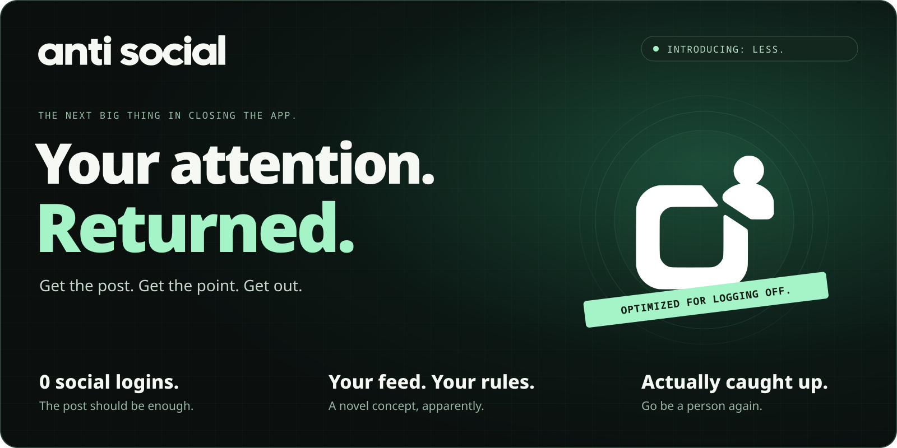

  

  <strong>The social media app with a deeply questionable growth strategy: you leave.</strong>

  

  <a href="https://github.com/MimirLab/anti-social/releases">Release notes &amp; source</a> &nbsp;·&nbsp;
  <a href="docs/READER_GUIDE.md">Take a look around</a> &nbsp;·&nbsp;
  <a href="docs/CAPABILITIES.md">What works today</a>

## Social media, minus the hostage situation.

The café put its hours on Facebook. Your friend sent an Instagram link. The event details are buried three apps deep. You wanted some information. Somehow that became an onboarding funnel.

**anti social gets the useful stuff out of social media—and gets you out of social media.** Public posts, linked articles, local businesses, events and communities, brought into a native Android reader you control. No social account required.

Anti social media. Pro having a life.

## Meet the features our imaginary investors hate.

<table>
<tr>
<td width="50%" valign="top">

### Read once. Collect the rest.

The same announcement on three platforms can become one collected post. Repeated text and pictures fold together; original editions and their comment streams stay within reach. Cleaner captions. Readable names. Less link confetti.

</td>
<td width="50%" valign="top">

### A feed that can be finished.

Chronological posts. A remembered reading position. New arrivals wait for you to adopt them. Continue where you left off, jump to newest, and reach an actual caught-up boundary.

</td>
</tr>
<tr>
<td width="50%" valign="top">

### Open the link. Skip the initiation.

Someone sends a social post. You open it in the reader. Public routes and surviving archive copies help recover the information, with the original source kept attached. Your friend's meme should not require a new digital identity.

</td>
<td width="50%" valign="top">

### Discover on purpose.

Explore related accounts through public connections and creator recommendations. Follow those connections across platforms. Build channels with your own rules. Decide what deserves your attention.

</td>
</tr>
<tr>
<td width="50%" valign="top">

### Find something worth leaving for.

Nearby businesses, the right restaurant branch, menus, workshops and dated events. Public information gathered into useful cards, with more details filling in as they're found. The internet can be a way to get somewhere.

</td>
<td width="50%" valign="top">

### Save means keep.

Preserve local copies of posts and selected media. Organize collections. Search retained material. Export your subscriptions and reader state. When a frontend disappears, your saved recipe should still be a recipe.

</td>
</tr>
</table>

## We repurposed the engagement funnel.

Public routes race to find useful content. The first usable results arrive first; slower enrichment fills in behind them. Cross-posts collect, clutter folds away, and deeper material waits where you can choose to inspect it.

All that machinery has one very unfashionable purpose: **help you get informed, then give you your time back.**

| The pitch | The anti social interpretation |
| :--- | :--- |
| **Engagement** | Get what you came for. Close the app. |
| **Retention** | Keep an actual local copy. |
| **Personalization** | Rules you can inspect, change and export. |
| **The algorithm** | Chronological order. A difficult innovation. |
| **Growth strategy** | Go outside. We'll cope. |

## Optional AI. Entirely your call.

Ordinary reading, search, filters and local discovery work without a language model. Enable AI if you want Context briefs across a collected post, its linked material and available discussions. Use local models, your own server, or cloud credentials you choose. Local text components install on demand and can be removed separately.

The app is the product. AI is an option in the settings.

---

  <strong>“Slop consumed, go be productive.”</strong> 
  An actual message in the app. We mean it.

  

  Android 8+ · No social login · Open source 
  Install the APK. Install future updates over it to keep your local state. This link always follows the latest official release.

<strong>Under the hood, the fine print, and how to contribute</strong>

### Your reader, your records

Settings, subscriptions and reading history stay local. App requests pass through the same protection gateway, including media and redirects. Tor is optional for ordinary reading and fails closed when selected; regional lookup and public-index searches use Tor. Direct public reads reveal your IP to their hosts. See the [hardening guide](docs/HARDENING.md).

Public-source access varies. A login wall, an empty frontend and unavailable comments remain failures. Collection and AI briefs can miss information; original sources remain available for inspection. The app works on stock, unrooted Android phones; current optional local text, translation and OCR tools require a supported 64-bit device. See [capabilities and limits](docs/CAPABILITIES.md) and [release qualification](docs/RELEASE_QUALIFICATION.md).

### For the curious and the builders

- [Reader guide](docs/READER_GUIDE.md)
- [Related-account discovery](docs/ADJACENT_DISCOVERY.md)
- [Public Instagram preview route and limits](docs/INSTAGRAM_PUBLIC_PREVIEWS.md)
- [Build from a clean checkout](docs/BUILDING.md)
- [Feed performance](docs/FEED_PERFORMANCE.md)
- [Development evidence](docs/DEVELOPMENT_HISTORY.md)
- [Source and publishing](docs/PUBLISHING.md)

Contributions should make useful content easier to reach and easier to leave. Start with a failing public-source fixture or a reader journey. Preserve source evidence and keep slow enrichment behind the first useful results. Repository instructions live in [AGENTS.md](AGENTS.md).

### Credit where it's due

anti social uses Darwin's rebuilt and expanded routing system. Darwin provenance, upstream notices and corresponding native source are preserved. GPL-3.0-or-later; see [LICENSE](LICENSE). Releases include the matching source and checksums.

