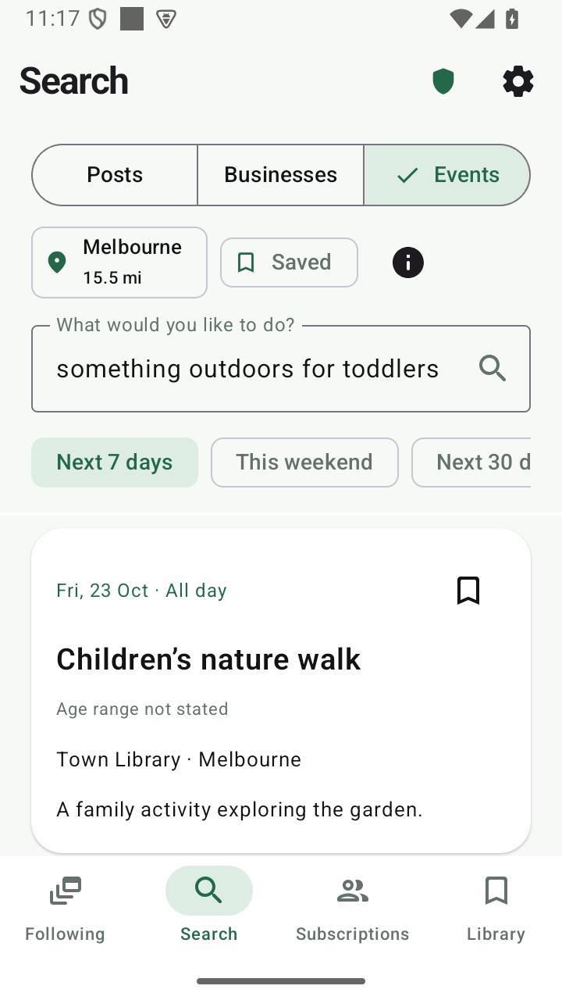
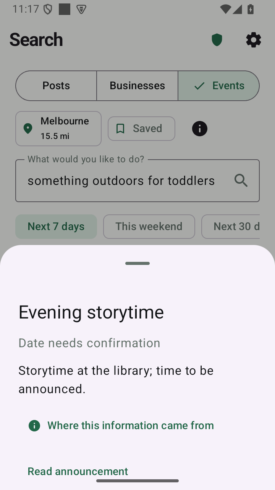

# anti social

**The useful parts of social media, without an account.**

anti social is a native Android reader that brings public posts, linked articles,
local businesses and events into one chronological, readable place. Catch up,
keep what matters, and get on with your day.

[Download the latest Android APK](https://github.com/MimirLab/anti-social/releases/latest/download/anti-social.apk)
· [Releases and corresponding source](https://github.com/MimirLab/anti-social/releases)
· [What works, and its limits](docs/CAPABILITIES.md)

The 0.36 development candidate is being qualified; the download link continues
to serve the current official release.

## Read on your terms

- Open shared social links through healthy public routes and archive recovery.
- Follow accounts and ordinary RSS/Atom feeds; organize subscriptions into channels.
- Read collected cross-posts once, with access to their original editions and comment streams.
- Keep your reading position, adopt incoming posts deliberately, and reach a caught-up boundary.
- Find nearby businesses, their public social accounts, branch menus and dated events.
- Save local copies, search retained material, and export your reader state.

The app uses Darwin’s rebuilt and expanded routing system. Public-source availability
varies: a login wall, an empty mirror and unavailable comments remain failures,
not successful content. See the [capability guide](docs/CAPABILITIES.md).

## Native screens

 

Android emulator screenshots with synthetic test data; physical-phone qualification is separate.

## Privacy and optional AI

Settings, subscriptions and reading history stay on your device. Network requests
pass through the same protection gateway, including redirects and media. Tor is
optional for reading and fails closed when selected; regional lookup and public
index searches use Tor. Opening public content directly reveals your IP to its host.

Ordinary reading, search, filters and local discovery work without a language model.
Enable optional AI to add Context briefs, using local models, your own server, or
cloud credentials you choose. Local inference components and model weights are
installed on demand and can be removed separately.

Flyer text recognition uses a small local OCR reader, independently of optional
language models. Context is an aid to reading source material, not a guarantee
that every useful fact will be retained.

## Install and update

Use the APK link above on a stock, unrooted Android device running Android 8 or
later. Android may ask you to allow installation from your chosen downloader.
Current optional local text, translation and OCR tools require a supported 64-bit
device. No root, ADB, social account or developer credential is needed for ordinary use.

The fixed download link always follows the latest official release. Install an
update over your existing app to preserve local state. Development previews are
qualified separately from official releases.

## Build or contribute

[Build from a clean checkout](docs/BUILDING.md) · [Test journeys and release gates](docs/RELEASE_QUALIFICATION.md)
· [Reader guide](docs/READER_GUIDE.md) · [Feed performance](docs/FEED_PERFORMANCE.md)
· [Development evidence](docs/DEVELOPMENT_HISTORY.md)

Start with one failing public-source fixture or reader journey. Keep acquisition
passive, preserve source evidence, and ensure a slow enrichment cannot delay the
first useful content. See [AGENTS.md](AGENTS.md) for repository constraints.

## License

GPL-3.0-or-later; see [LICENSE](LICENSE). Upstream components, Darwin provenance,
source-specific notices and corresponding native source are preserved. APKs are
published with their matching source and checksums; see [publishing](docs/PUBLISHING.md).
