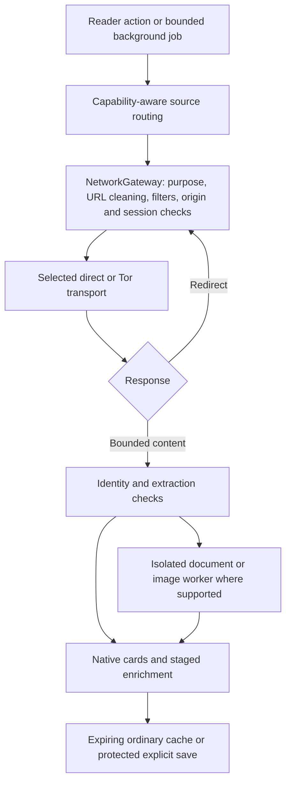

# How anti social's systems work together

anti social is a released native Android reader with accountless retrieval,
multiple public source routes, local reader state and optional AI. Its security
and reliability come from cooperating layers. This is the starting map for code
review; [reviewing and evidence](REVIEWING.md) explains how to assess a particular
release. The [reader guide](READER_GUIDE.md) covers normal use.

## Connection modes and app-wide Tor

**Settings → Privacy & connection → Tor for all traffic** routes the app's
content, photos, videos and updates through its embedded Tor service. It works
on stock Android without root or another Tor application. Requests pause while
Tor is unavailable; choosing another content source does not authorize a direct
connection. This control is separate from the always-Tor transport used by
commercial public-index searches and regional discovery.

| App request | All-traffic Tor off | All-traffic Tor on |
| --- | --- | --- |
| Ordinary public reading, media, source probes, archives, downloads and updates | Direct connection | Tor; paused if unavailable |
| Commercial public-index searches, regional discovery and protected image-search routes | Separate Tor connection | Tor |
| Darwin alternative search routes | Selected content connection: direct | Tor |
| Explicit remote AI/service endpoint | Selected content connection: direct | Tor |
| Explicit loopback/LAN model server | Only the selected, tightly scoped local endpoint | Blocked; no hidden direct exception |
| Installed on-device model computation | Local computation | Local computation |

The control governs anti social's networking, not other Android applications.
An explicit external-app/browser handoff uses that other application's connection.
Local computation can still need a gateway download when a model is installed.

[SettingsScreen](../app/src/main/kotlin/app/antisocial/android/SettingsScreen.kt)
contains the control;
[Repository.applyNetworkSettings](../app/src/main/kotlin/app/antisocial/android/Repository.kt)
connects preferences to
[TorController](../app/src/main/kotlin/app/antisocial/android/TorController.kt).
[NetworkGateway](../core/src/main/kotlin/app/antisocial/core/NetworkGateway.kt)
maintains separate default and Tor-required sessions. Updating search readiness
does not switch ordinary direct content to Tor. Enabling all-traffic Tor also
updates the default content session. A mode change invalidates queued requests,
old clients, responses and scoped validators; switching direct → Tor → direct
does not revive the old session. The SOCKS transport is owned by an app-private
Tor process, with readiness checked before a client can issue requests.

## A source route never bypasses the protection path

The gateway is shared by adapters, media, feeds, archive recovery, Context,
model/service calls and updates. It applies Darwin-derived URL cleaning and
compiled network filters before connections, and reapplies destination checks
after rewrites and every redirect. Ordinary public reads reject insecure/private
destinations and credentials; direct DNS resolution rejects private addresses.
Changing a frontend therefore preserves the same protection and Tor policy.

Public acquisition keeps no social login session. Generic cookies and service
credentials are stripped. Narrow exceptions are explicit: a validated
source-scoped pagination bookmark can carry its non-account cursor, and a chosen
service endpoint can receive the user's configured credential. Service requests
are pinned to that endpoint and are not repeated across redirects.

Automatic supplemental reading also screens action-bearing links such as reset
or unsubscribe endpoints. Their source URLs remain available for deliberate
opening. Filters start from a bundled compiled snapshot or a valid saved one;
daily update work preserves working protection during refresh failures. Android
can defer that scheduled work. See [hardening](HARDENING.md) for exact bounds,
filter refresh and decoder behavior.

## How the layers combine on an ordinary read

Consider a post whose first frontend fails and whose replacement contains an
image and an article link. The controls below apply to different parts of that
same journey; passing one check does not remove the others.

| Stage | What the app does | Where to follow it |
| --- | --- | --- |
| Choose another route | Select an eligible method for the requested capability; require usable, matching content before treating it as delivery. | `SourcePool.load`, its adapter factory and `PublicPathways` |
| Fetch the replacement | Apply the current connection policy, URL cleaning, compiled filters, origin/credential restrictions and request budgets. Recheck redirect destinations. | `NetworkGateway` |
| Receive after a mode change | Reject a response or client belonging to the old privacy session. A direct → Tor → direct round trip creates a new session. | `NetworkSession` and Gateway execution guards |
| Decode the picture | Fetch through the gateway, then give the documented decoder worker one read-only input. Validate bounded returned pixels; reuse a decoded cache hit. | `Repository` media path and `ContentSandbox` |
| Read an attached article | Use the shared bounded public-copy resolver. Supplemental reading screens action links; relevant document extraction runs in its isolated worker. | `PublicArticleResolver`, `FetchPurpose` and `DocumentSandboxService` |
| Keep the result | Retain canonical attribution and source evidence. Apply ordinary cache expiry separately from explicit saves and offline downloads. | Repository, cache and Library consumers |

These are complementary controls: Tor governs the connection; filters screen
requests; source checks establish what was retrieved; worker isolation limits
the authority available while decoding; parent validation bounds what comes
back. Automatic retrieval does not launch the site's JavaScript. A deliberate
external-browser handoff is a separate action outside the app's transport.
The worker/format exceptions and their tested scope are documented below and
in [hardening](HARDENING.md#workers-and-authority).

## Redundancy includes different methods and learned delivery

The pool combines Darwin's donor instances with separately reviewed
[public pathways](../app/src/main/assets/public-pathways.json), source-specific
parsers, selected federated origins and capability-specific alternatives. Post,
profile, search, comments, media and chronological feed operations have distinct
contracts. The wider [source atlas](../app/src/main/assets/source-discovery.json)
also contains research candidates and gated leads; its presence alone does not
activate them.

[SourcePool](../core/src/main/kotlin/app/antisocial/core/Adapters.kt) selects
eligible sources using observed content, latency, cooldown and transport. Fresh
healthy routes keep priority. Unproven methods are interleaved before more
mirrors of the same method. Rolling hedges use available slots without waiting
for every older request; a winner cancels losing work. Accountless originals
remain behind alternatives and require the original-access setting. Matching
archive recovery has its own historical role. A source switch never silently
changes Tor or the selected public search provider.

A reachable homepage, login wall, unrelated profile or empty shell is not working
content. An undated preview cannot certify a feed refresh. Source identity,
ownership of cursors, extraction coverage and canonical original links survive
the route that fetched them. Route failure is not proof that all remaining paths
fail. Conversely, several mirrors can share an upstream: redundancy is measured
by useful delivery, not just a hostname count.

[Adaptive route maintenance](../core/src/main/kotlin/app/antisocial/core/RouteHeartbeat.kt)
uses actual demand, passive reads, shared host/global budgets, cancellation and
increasing delays for stable or repeatedly failed plans. It does not continuously
poll every registered source. Foreground reading takes priority. See
[scheduling](ROUTE_SCHEDULING.md), [measurements](ROUTE_LATENCY.md) and
[local-discovery routing](LOCAL_DISCOVERY_ROUTING.md).

[Public-index continuations](SEARCH_SCHEDULING.md) retain a fast first answer
and give unfinished query shapes their turn. The ordinary search feed can also
receive available pages while that work continues, through a selected-source,
checkpointed progress path. The plan preserves the chosen source/query, privacy
session and existing attempt allowance; stopping cancels its children.
Useful delivery and provider availability are learned separately: a late
refusal keeps the delivered cards while pausing further work at that index.
The pause covers its post search, account directory and probes across platforms,
with endpoint/transport scope. An in-flight success cannot erase it. Other
eligible methods remain subject to the same provider, original-access and
Gateway rules. See the [provider-pause path](SEARCH_SCHEDULING.md#useful-content-and-a-provider-pause-can-coexist).

## Acquisition, decoding, interpretation and retention are separate boundaries

Passive HTML acquisition does not run a site's scripts or embedded widgets.
Bounded structural admission precedes relevant DOM allocations. Ordinary images,
PDF display, article extraction and document preparation use read-only
descriptor-based isolated workers where documented; an independent watchdog can
terminate stalled parsing. Returned pixels/text/fields are checked by the parent.
The HEIF/AVIF compatibility path and model workers have different authority,
explicitly described in [hardening](HARDENING.md). A private process and an Android
isolated process are different mechanisms.

Optional model/runtime installation adds pinned hashes, signed catalogues and
verified runtime packs. Ordinary retrieval and filtering work with AI disabled.
Remote AI is an explicitly configured data destination, reached through the same
gateway; the text model does not control arbitrary networking or source routing.

Ordinary caches have expiry and space limits. Temporary extraction files have
bounded ownership and cleanup. Saved material and explicit offline downloads
are protected separately; clearing ordinary cache is not deletion of a user's
saved copies. Metadata/signature validation stays attached to the actual bytes
checked. These boundaries reinforce one another without requiring a server-side
reader profile or social login.
